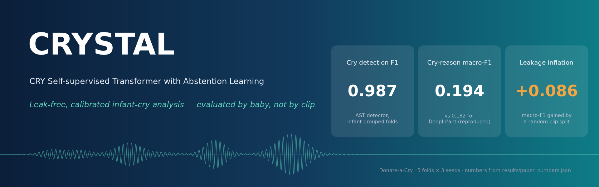
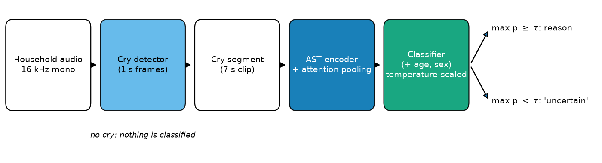
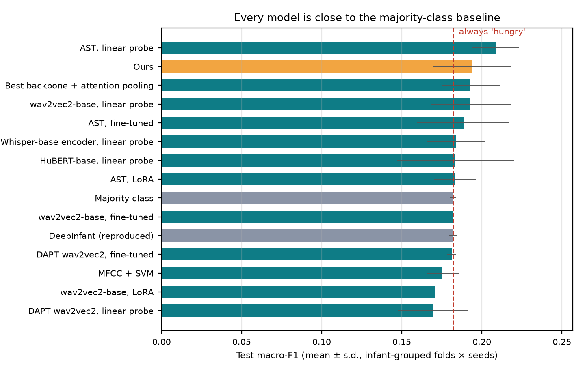
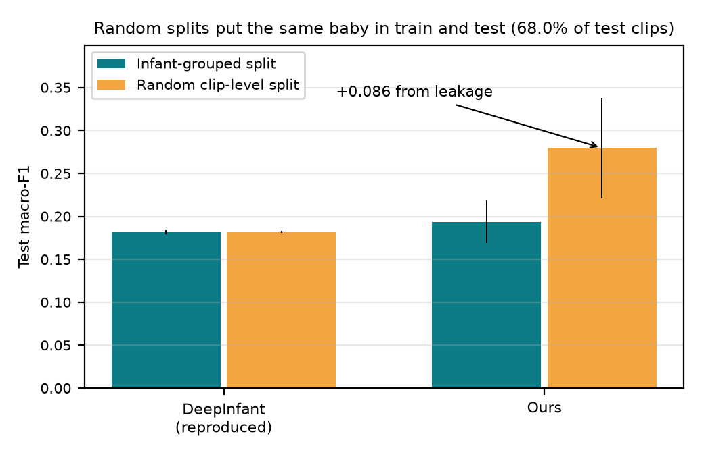
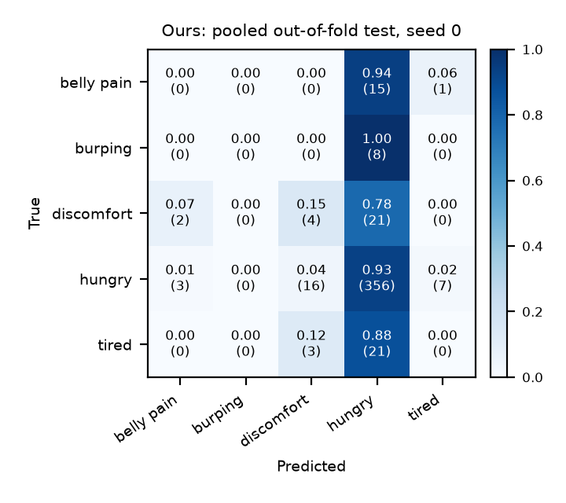
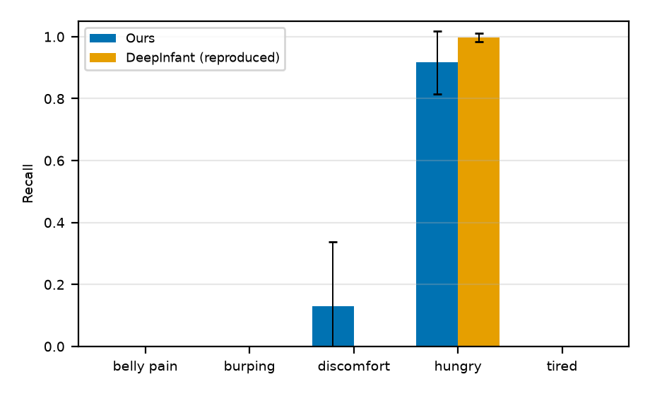
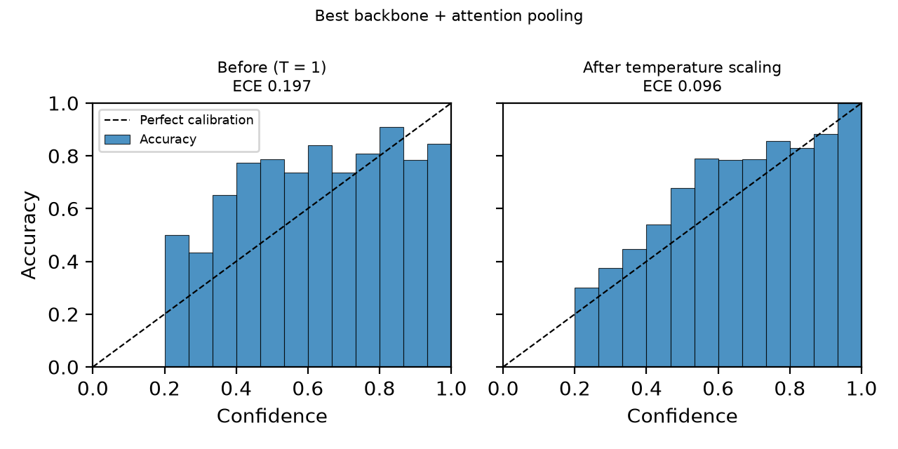
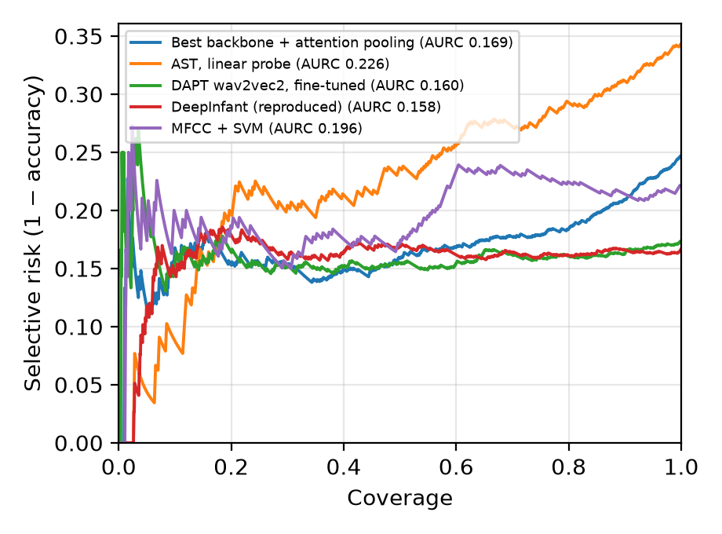

<p align="center"></p>

<p align="center">
  
  
  
  
  
  
  
</p>

# CRYSTAL — leak-free infant cry analysis

**CRYSTAL** (CRY Self-supervised Transformer with Abstention Learning) is a two-stage infant-cry
pipeline: (1) a detector finds cries in audio, (2) a classifier predicts the likely reason
(Donate-a-Cry labels: belly pain, burping, discomfort, hungry, tired) with calibrated confidence and may abstain. Every
model, including a reproduced [DeepInfant](https://github.com/skytells-research/DeepInfant) baseline,
is evaluated under the same **infant-grouped** 5-fold protocol (3 seeds, macro-F1 as primary metric).

All results (good and bad) are in [`results/RESULTS.md`](results/RESULTS.md); the paper's numbers
come only from [`results/paper_numbers.json`](results/paper_numbers.json). Neither file is edited
by hand, so every reported number can be traced back to a saved run.

> **Not a medical device.** This is research code. Cry-reason predictions on current public data are
> not reliable enough to act on; see the findings below.

## At a glance

**How it works.** Audio is screened by a small cry detector; each detected cry goes to an audio
spectrogram transformer (AST) that predicts the reason, and the system says "uncertain" when its
calibrated confidence is too low.

<p align="center"></p>

**1. Evaluated by baby, almost every model is close to chance.** Always answering "hungry" (the
largest class) is a strong baseline. Our model edges past the reproduced DeepInfant by a small
but statistically significant margin, and no method is far ahead of the dashed line.

<p align="center"></p>

**2. Leakage makes models look much better than they are.** When clips are split at random, the same
baby ends up in training and test data. A model that learns from audio then memorises babies and its
score jumps; the majority-class DeepInfant does not change.

<p align="center"></p>

**3. What the averages hide.** Almost every cry is predicted as "hungry"; the minority classes are
rarely or never recognised.

<p align="center">
  
  
</p>

**4. Calibration works, but abstention cannot create information.** Temperature scaling makes the
confidence honest, and abstaining raises precision, mostly by keeping "hungry" cries.

<p align="center">
  
  
</p>

**5. Cry detection is the part that works**, including a tiny CNN suitable for always-on screening.
Exact numbers for every table are in [`results/RESULTS.md`](results/RESULTS.md).

All charts and badges are generated from the saved results:
`python -m src.report && python scripts/make_readme_assets.py`.

## Three levels of reproduction

| Level | What you get | Needs | Time |
|---|---|---|---|
| **A** | every table, figure and paper number, from the committed run outputs | Python only | minutes, CPU |
| **B** | the dataset, dedup and the exact folds, checked against committed hashes | public audio (Donate-a-Cry) | ~10 min, CPU |
| **C** | re-train any experiment and compare | a GPU (Kaggle T4 notebooks provided); CryCeleb terms for DAPT / detection | hours |

### Setup

```bash
git clone https://github.com/IdrisKulubi/crystal && cd crystal
python -m venv .venv
.venv/Scripts/activate              # Windows   (Linux/macOS: source .venv/bin/activate)
pip install -r requirements.txt     # exact versions used: requirements-lock.txt (Python 3.13)
pytest -q
```

### A — regenerate all results from the committed run outputs (no audio, no GPU)

Every run folder in `results/runs/` holds the config, environment, per-fold test/val logits,
predictions and metrics the trainer wrote; `results/registry.jsonl` lists every run, including
failed ones.

```bash
python -m src.report        # -> results/paper_numbers.json, RESULTS.md, tables/, figures/
python -m src.fill_paper --template <your.docx>   # optional: fill a Word template (not included) from paper_numbers.json
```

On a fresh clone `src.report` reproduces the committed `paper_numbers.json` exactly (only the
`_generated_utc` timestamp changes). Significance tests (paired cluster bootstrap over infants,
10,000 resamples, seed 0) are recomputed if `results/significance/` is missing.

### B — rebuild the data and verify the protocol

Infant audio is never committed; fetch it from its public sources:

```bash
git clone --depth 1 https://github.com/gveres/donateacry-corpus data/raw/donateacry-corpus   # ODbL / DbCL
git clone --depth 1 https://github.com/skytells-research/DeepInfant baselines/DeepInfant      # Apache-2.0
git clone --depth 1 https://github.com/karolpiczak/ESC-50 data/raw/ESC-50                     # CC BY-NC 3.0 (noise pool, detector negatives)

python -m src.prepare_data     # raw -> data/processed + data/metadata.csv
python -m src.dedup            # exact + near-duplicate clusters, merged into split groups
python -m src.make_splits      # -> data/metadata_folds.csv (+ leakage assertions), data/metadata_randomsplit.csv
python -m src.dataset_stats    # -> results/dataset_stats.json (Table 1)
git diff --stat results/       # only figure PDFs change (they embed a creation date)
```

The DeepInfant clone is needed here too: its bundled audio is checked for overlap with
Donate-a-Cry (`overlap` in `dataset_stats.json`).

`make_splits` re-applies the committed fold assignment in `splits/` and asserts that no infant
(group) appears in more than one fold. The SHA-256 of the folds file is in
`results/splits_report.json`; the Kaggle notebooks refuse to train if it differs.

### C — re-train

Locally (any experiment config in `configs/exp/`):

```bash
python -m src.train --config configs/exp/E36_crystal.yaml            # 5 folds x seeds 0,1,2
python -m src.train --config configs/exp/E36_crystal.yaml --debug    # tiny smoke test -> results/debug/
```

On a GPU, use the notebooks in `notebooks/` (generated by `scripts/make_kaggle_notebook.py`): set
*Accelerator = GPU*, *Internet = On*, edit `CONFIGS`, *Run all*, download `crystal_results.zip`, then:

```bash
python -m src.import_runs crystal_results.zip   # copies new run folders, never overwrites
python -m src.report
```

| Notebook | Runs | Extra requirement |
|---|---|---|
| `kaggle_train.ipynb` | any reason-task configs (E00–E36, E90) | — |
| `kaggle_dapt.ipynb` | DAPT of wav2vec2 on CryCeleb (D01), then E20/E21 | `HF_TOKEN` secret of an account that accepted the CryCeleb2023 terms |
| `kaggle_detect.ipynb` | cry detectors E40 (AST) and E41 (small CNN) | same `HF_TOKEN` (CryCeleb positives) |

Order matters for configs with `parent_run: <experiment id>`: the parent is resolved to its latest
completed run at launch, so run E36 before its `E36-no*` ablations.

Other commands:

```bash
python -m src.calibrate --run <run_id>             # recompute calibration from saved val logits
python -m src.significance --a <run_id> --b <run_id>
python -m src.efficiency                           # params, fp32 size, CPU ms/clip on THIS machine -> results/efficiency.json
python -m src.listen_check                         # optional: a few clips per class for a listening audit
```

## Experiments

IDs, parents and paper rows are listed in `configs/project.yaml` and `results/registry.jsonl`; each
config states only what differs from `configs/defaults.yaml` and, unless it is a baseline, changes
one thing relative to its `parent_run`.

| Group | IDs |
|---|---|
| Baselines | E00 majority class, E01 MFCC + SVM, E02 DeepInfant reproduced |
| Frozen encoders + linear probe | E05 wav2vec2, E06 HuBERT, E07 AST, E08 Whisper encoder |
| Fine-tuning | E10–E17 (AST / wav2vec2: full vs LoRA, attention pooling, balanced sampler, focal loss, selection metric) |
| Domain-adaptive pretraining | D01 (CryCeleb), E20 probe, E21 fine-tuned |
| Augmentation / context | E30–E34 |
| Final model and ablations | E36 (Ours), E36-noContext / -noNoise / -noSpecAug / -noMixup / -noFocal |
| Cry detection | E40 AST, E41 small CNN |
| Leakage demonstration | E90-deepinfant, E90-ours (random clip-level split) |

## How results are tracked

Each run writes `results/runs/<run_id>/` and appends one line to `results/registry.jsonl`; run
folders are never overwritten. Tuning, early stopping, temperature scaling and abstention
thresholds use validation data only; test folds are predicted once per finalised configuration.
Run folders hold `config.yaml`, `env.json`, `summary.json` and, per fold × seed, `metrics.json`, `calibration.json`, `predictions.csv` and the test/validation logits.

## Data, privacy and licences

Infant audio is sensitive personal data. `data/`, `baselines/`, `checkpoints/` and all audio files
are git-ignored; nothing in this repo contains audio, and the Kaggle notebooks export only logits,
predictions, metrics and logs.

| Source | Use | Licence |
|---|---|---|
| [Donate-a-Cry](https://github.com/gveres/donateacry-corpus) | reason labels, detector positives | ODbL 1.0 / DbCL 1.0 |
| [CryCeleb2023](https://huggingface.co/datasets/Ubenwa/CryCeleb2023) (gated) | unlabelled DAPT corpus, detector positives | CC BY-NC-ND 4.0 — research use only; no derived model is released |
| [ESC-50](https://github.com/karolpiczak/ESC-50) | training-time noise, detector negatives | CC BY-NC 3.0 |
| [DeepInfant](https://github.com/skytells-research/DeepInfant) | baseline architecture | Apache-2.0 |

## Licence

Code: Apache-2.0 (see [`LICENSE`](LICENSE)). Reused DeepInfant code keeps its Apache-2.0 notice.
